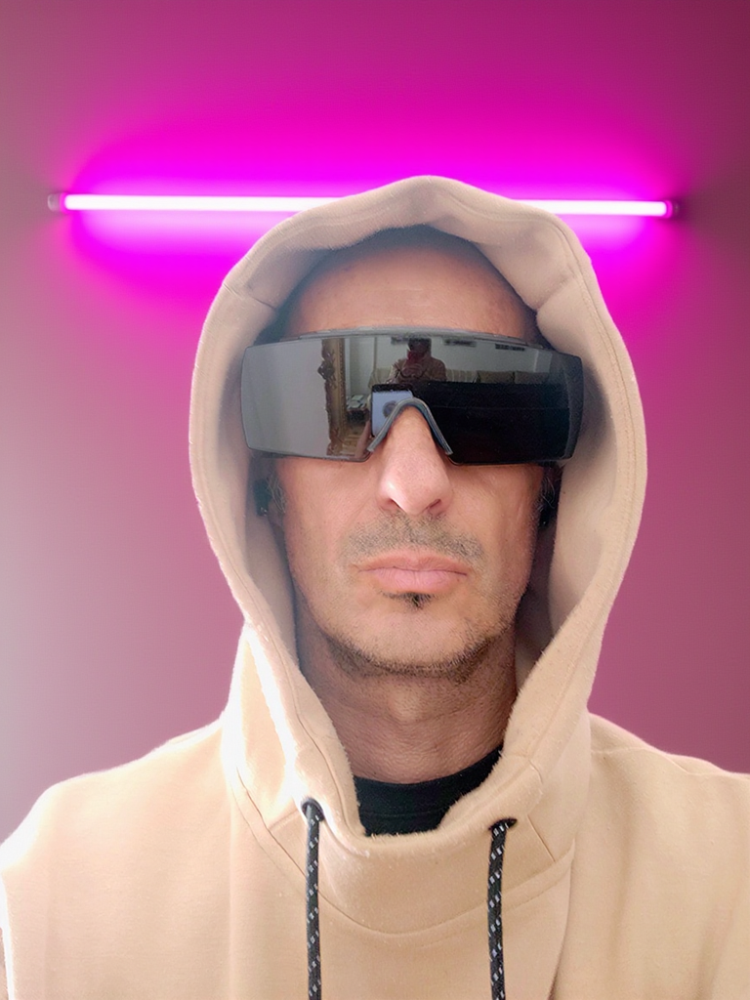

# Open Studio for Affinity

### Affinity is free. Its AI isn't. So I made it free too.

**Open Studio for Affinity** brings free, local generative AI into [Affinity](https://www.affinity.studio/), powered by [ComfyUI](https://github.com/comfyanonymous/ComfyUI) and the Affinity MCP.
It's an open alternative to Canva's paid AI features: no subscription, no credits, no cloud. Everything runs on your own GPU.

---

## Features

### ✏️ Edit (the main feature)
Add, change or remove anything just by describing it. Powered by **Flux Kontext**.
Write something like *"a pink neon bar mounted horizontally on the wall, above his head"* and the edited image comes back to Affinity as a new layer.

### 🪄 Expand (beta)
Make your image wider or taller with AI, for example to turn a vertical photo into a horizontal banner. Powered by **SDXL inpainting**.
Enlarge the canvas in Affinity, describe what should appear in the new space, and the empty area is filled to match your image.

---

## Before & after

| Original | Edit | Expand |
|:---:|:---:|:---:|
|  |  |  |
| A plain portrait, 768 × 1024 | **Edit:** pink neon light added, with its glow on the wall and the hood | **Expand:** the vertical image turned into a 1366 × 1024 banner |

---

## How it works

```
┌──────────┐     ┌──────────────┐     ┌──────────┐     ┌──────────────┐
│ Affinity │ ──► │   Web app    │ ──► │ ComfyUI  │ ──► │  New layer   │
│ your     │     │ your prompt  │     │ the AI   │     │  in Affinity │
│ image    │     │              │     │          │     │              │
└──────────┘     └──────────────┘     └──────────┘     └──────────────┘
```

1. You open an image in Affinity and write what you want in the Open Studio web app.
2. The app (`server.py`, a tiny local server that only uses the Python standard library) loads the right ComfyUI workflow, puts your prompt in it and sends it to ComfyUI.
3. The **Affinity Bridge** custom nodes (`affinity_bridge/`) use the Affinity MCP to take the current document from Affinity. When the AI is done, they place the result back as a new layer named after your prompt (e.g. `Edit: a pink neon bar mounted…`).

Everything stays on your computer: the web app runs at `http://127.0.0.1:8190` and ComfyUI at `http://127.0.0.1:8188`.

---

## Requirements

- **Windows** (the only system it has been tested on)
- **NVIDIA GPU with 8 GB of VRAM or more**
- **Python 3** from [python.org/downloads](https://www.python.org/downloads/), to run the web app (nothing to `pip install`)
- **[ComfyUI](https://github.com/comfyanonymous/ComfyUI)**
- **Affinity** with **"Enable Affinity MCP"** turned on in its settings, and file access allowed

### Custom node packs

| Node pack | Used by | Nodes | Get it |
|---|---|---|---|
| **Affinity Bridge** (included) | Edit + Expand | `Affinity: Coger imagen`, `Affinity: Enviar imagen` | The `affinity_bridge` folder of this repo |
| **ComfyUI-GGUF** | Edit | `UnetLoaderGGUF` | [github.com/city96/ComfyUI-GGUF](https://github.com/city96/ComfyUI-GGUF) |
| **ComfyUI-KJNodes** | Expand | `GrowMaskWithBlur` | [github.com/kijai/ComfyUI-KJNodes](https://github.com/kijai/ComfyUI-KJNodes) |

All the other nodes are built into ComfyUI.

### Models

| File | Used by | Put it in | Get it |
|---|---|---|---|
| `flux1-kontext-dev-Q4_K_M.gguf` | Edit | `ComfyUI/models/unet/` | [QuantStack/FLUX.1-Kontext-dev-GGUF](https://huggingface.co/QuantStack/FLUX.1-Kontext-dev-GGUF) |
| `clip_l.safetensors` | Edit | `ComfyUI/models/text_encoders/` | [comfyanonymous/flux_text_encoders](https://huggingface.co/comfyanonymous/flux_text_encoders) |
| `t5xxl_fp8_e4m3fn_scaled.safetensors` | Edit | `ComfyUI/models/text_encoders/` | [comfyanonymous/flux_text_encoders](https://huggingface.co/comfyanonymous/flux_text_encoders) |
| `ae.safetensors` (Flux VAE) | Edit | `ComfyUI/models/vae/` | [black-forest-labs/FLUX.1-Kontext-dev](https://huggingface.co/black-forest-labs/FLUX.1-Kontext-dev) (accept the license first) |
| `juggernautXL_v8Rundiffusion.safetensors` | Expand | `ComfyUI/models/checkpoints/SDXL/` | [Juggernaut XL on Civitai](https://civitai.com/models/133005/juggernaut-xl) (version *V8 + RunDiffusion*) |

> The Expand workflow looks for the checkpoint inside an `SDXL` subfolder. If you put it somewhere else, open `workflows/relleno.json` in ComfyUI and select it again.
>
> The Edit workflow also contains an upscaler (`4x-UltraSharp.pth`) that isn't connected to anything, so you don't need to download it.

---

## Installation

1. **Install ComfyUI** and check that it opens at `http://127.0.0.1:8188`.
2. **Install the node packs** *ComfyUI-GGUF* and *ComfyUI-KJNodes* with ComfyUI-Manager, or `git clone` them into `ComfyUI/custom_nodes/`.
3. **Install Affinity Bridge:** copy the `affinity_bridge` folder of this repo into `ComfyUI/custom_nodes/`.
4. **Download the models** in the table above into the right folders.
5. **Restart ComfyUI.** The Affinity Bridge nodes should load without errors in the console.
6. **Set up Affinity:** in its settings, turn on **Enable Affinity MCP** and allow file access.
   Images are exchanged through a `ComfyAffinity` folder on your Desktop (Affinity can only read and write there). It's created automatically.
7. **Download this repo** (green *Code* button → *Download ZIP*, or `git clone`) and unzip it anywhere.

## Usage

1. Start **ComfyUI**.
2. Open your image in **Affinity**.
3. Double-click **`Start Open Studio.bat`**. The app opens in your browser.
4. Choose **Edit** or **Expand**:
   - **Edit:** describe the change in English.
   - **Expand:** first enlarge the canvas in Affinity (*Document → Resize Canvas*), then describe what should appear in the new space.
5. Press **Generate** (or `Ctrl + Enter`). The progress bar shows each step.
6. The result appears in Affinity as a **new layer** named `Edit: …` or `Expand: …`.

---

## 💡 Tip for Edit: say where it goes and how it lights the scene

Flux Kontext gets much more realistic when you tell it **where** the new object goes and **how its light affects the scene**, not just what it is.

❌ *"Add a neon light"*

✅ *"a pink neon bar mounted horizontally on the wall, above his head, casting pink light onto the wall and the hood"*

This is the exact prompt used for the Edit example in the gallery above.

---

## Limitations (honestly)

- **Expand is in beta.** Results vary a lot between runs, and you may sometimes see seams where the old and new areas meet. Generate 2 or 3 times and keep the best one.
- **Edit takes about 2 minutes** on an 8 GB GPU.
- **Affinity sometimes gets stuck** answering the MCP. The node already retries on its own; if it still fails, restarting Affinity fixes it.
- **Only tested on Windows.**
- The Affinity Bridge node names and messages are currently in Spanish.

---

## Licenses

- **The code in this repo** (web app, server and Affinity Bridge nodes) is released under the [MIT License](LICENSE).
- **The AI models are not included.** Each one has its own license; check it before using them.
- ⚠️ **FLUX.1 Kontext [dev] has a non-commercial license** (*FLUX.1 [dev] Non-Commercial License* by Black Forest Labs). Read it before using it for any commercial work.

---

## Next steps

- **Creative presets** to help you write better prompts: lighting, styles and common edits in one click.

---

## Credits

- [ComfyUI](https://github.com/comfyanonymous/ComfyUI), the engine that makes all of this possible.
- [ComfyUI-GGUF](https://github.com/city96/ComfyUI-GGUF) by city96 and [ComfyUI-KJNodes](https://github.com/kijai/ComfyUI-KJNodes) by kijai.
- Black Forest Labs for FLUX.1 Kontext, and RunDiffusion for Juggernaut XL.
- Made by **Amador ([viriato68](https://github.com/viriato68))**.

**#OpenSourceHiggsfield**
